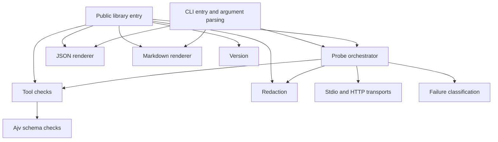

# Architecture

JOONS MCP Probe 0.1.0 is a read-only MCP server inspection and validation toolkit. This document describes the integrated implementation.

## Module map

| Module | Responsibility |
| --- | --- |
| `bin/joons-mcp-probe.js` | CLI entry point. |
| `src/cli.js`, `src/args.js` | CLI arguments, exit codes and output destinations. |
| `src/index.js`, `src/version.js` | Public exports and version constant. |
| `src/probe.js` | Step orchestration, timings and report assembly. |
| `src/transports.js` | Stdio and Streamable HTTP connections and child cleanup. |
| `src/diagnose.js` | Classify operational failures. |
| `src/checks/tools.js` | Pure raw tool inspection and findings. |
| `src/checks/schema.js` | Bounded schema copying and Ajv compilation. |
| `src/report/json.js`, `src/report/markdown.js` | Render reports. |
| `src/redact.js` | Secret, URL and header redaction. |

## Inspection pipeline

1. **Connect:** spawn the stdio child without a shell, or open the Streamable HTTP transport. Record `connectMs`.
2. **Initialize:** perform the SDK handshake; record server identity, negotiated protocol, capabilities and whether instructions were present. Record `initializeMs`.
3. **List tools:** only when `capabilities.tools` is present, request `tools/list`, retain raw tool entries, follow `nextCursor`, and run the checks. A repeated cursor or more than 50 pages produces `TOOLS_PAGINATION_LOOP`. If the capability is absent, skip listing and add `CAPABILITY_TOOLS_MISSING`. An empty advertised tool list produces `TOOLS_EMPTY`. Record `toolsListMs` when this step runs.
4. **Close:** close the transport and clean up the child process tree. Record overall `totalMs`, including cleanup.

The raw list is obtained without SDK validation stripping or rejecting malformed tool entries, so checks can report defects instead of treating those entries as a client schema failure. `checkTools` returns item summaries and findings without I/O. Ajv uses draft-07 or draft 2020-12, non-strict compilation, all errors, and disabled format validation. The checks reject cyclic, oversized, accessor-bearing or unsafe-key schema data before compilation.

Operational server problems become a structured failure report. Invalid API arguments can throw `TypeError`. See [API.md](API.md) for report fields and status precedence.

## Timeouts, bounds and cleanup

Inspection is bounded by totalTimeoutMs; cleanup has a separate closeTimeoutMs budget (default 3000). probe() always resolves within totalTimeoutMs + closeTimeoutMs + 1000 ms, including scheduling and report finalization. The default step budget is 10000 ms; totalTimeoutMs defaults to 30000 ms. Stderr and pagination retain their byte/page bounds.

Incoming stdio messages, HTTP JSON bodies and SSE events are capped before SDK parsing at 4 MiB each by default; cumulative incoming bytes are capped at 16 MiB. Exceeding either byte bound produces `RESPONSE_TOO_LARGE` and `invalid_response`. At most 10,000 tools are collected by default; overflow produces `TOOLS_LIMIT_EXCEEDED`. Notifications are scanned incrementally, not retained. Schema inspection additionally enforces bounded size and depth.

The owned stdio adapter uses public SDK ReadBuffer/serializeMessage utilities and child_process.spawn with shell:false; it never accesses private SDK process state. On POSIX it creates a detached process group and kills/verifies the group, including when the parent has exited. On Windows a hidden Toolhelp helper identifies descendants, excludes processes older than the owned root, and rejects a reused root PID. It retains kernel handles while terminating recorded descendants so their PIDs cannot be recycled before termination. The adapter attempts `taskkill /PID <pid> /T /F`, falls back to direct SIGKILL of the retained child, then verifies the root and recorded descendant PIDs. Already-exited processes are success. If permissions or the deadline prevent verification, `CLEANUP_INCOMPLETE` is a connection warning containing redacted diagnostics; it does not create a fatal failure. Every close promise is observed immediately and close is idempotent and non-rejecting. The same cleanup path handles success, error, timeout and SIGINT. Total duration includes cleanup. Windows tests relay the JS SIGINT event into the actual CLI because Node's process.kill(SIGINT) terminates Windows processes without running handlers; this is handler-path proof, not native console-control delivery proof.

SDK compatibility is constrained to ~1.32.2, and the permissive tools/list result schema uses the directly declared Zod dependency. HTTP lifecycle delegation uses only public transport methods and callbacks.

The schema worker receives the remaining tools/list deadline (the earlier step/total limit, with a small return margin). Checks test elapsed time between tools, schema copies and compilations, then return partial summaries on exhaustion. A single in-progress compilation is additionally bounded by terminating the worker. Exhaustion produces `CHECKS_BUDGET_EXCEEDED`, `SLOW_STEP` and failure kind `timeout`. Server-sized arrays are copied/appended with iteration rather than function-argument spread; a 150,000-entry page reaches `TOOLS_LIMIT_EXCEEDED` without hitting the JavaScript argument limit.

Windows executable selection uses the effective child PATH and PATHEXT and rejects .cmd/.bat targets before spawn. This also covers shims accompanied by extensionless POSIX scripts. The documented opt-in `stdio -- cmd.exe /d /s /c <file>` names a native executable explicitly; the caller chooses shell semantics, and the probe never changes spawn to shell:true.

## Read-only protocol guarantee

The only allowed MCP methods are `initialize`, `notifications/initialized`, `tools/list`, and `ping`. The probe must not invoke `tools/call`, `resources/read`, `prompts/get`, or any other MCP method. In particular, listing a tool does not execute it. Opening the transport and spawning a server are necessary local connection operations; the guarantee concerns the protocol methods the probe sends.

## Redaction and untrusted output

Credential matches in server text or untrusted map keys produce SECRET_IN_RESPONSE without quoting the credential. Error messages and stderr use the same sanitizer.

Known secrets and sensitive transport values are collected first. Server free-text values and stderr chunks are scanned incrementally, keeping only a boundary suffix for split stderr matches. The report is sanitized by schema path before return; the CLI applies the same value-only policy before rendering and freezes its exit decision beforehand. Neither layer masks serialized JSON/Markdown. Output write failures return exit code 4, separate from usage errors (3); --version imports the public VERSION constant.

Every supplied non-empty secret, of any length, and its supported encoded forms is masked as a substring in all free-text values and untrusted object keys, including capabilities and displayed schemas. There is no whole-token exception. Only contract-controlled keys and fields are preserved: schemaVersion, tool metadata, timestamps, target.transport, status, timings, counts/pages, booleans/numbers, finding IDs/severity/category, failure kind/step/exitCode, and SDK-known protocol versions. Status and exit code are computed before redaction. Redacted key collisions receive deterministic numeric suffixes without discarding values. Unknown transformations and credentials remain outside this matching policy.

Server data is copied iteratively with a maximum nesting depth of 64 before SDK/report use. Deeper data or cycles are replaced with [depth limit] and produce RESPONSE_TOO_DEEP (warning, connection). Redaction and renderers share the depth bound; schema checks use bounded copies and a terminable worker. A size-bounded 10,000-level response therefore resolves to a Report rather than throwing.

The shared redactor compiles literal, URL-encoded, UTF-8 base64 and base64url variants once per probe, including Bearer and conventional user:secret Basic forms. Full supplied Authorization values, Bearer token components, decoded Basic credentials and known URL credential pairs are registered. Incremental scanning uses the same variants as masking. The supported boundary is exact known literals/encodings, not arbitrary encryption, unknown credentials, or fragments removed before capture. Redaction precedes human formatting, escaping and truncation.

Treat all server-provided text as untrusted. Markdown output escapes pipe characters, backticks, HTML `<`, and newlines, and truncates each server-provided text value to 300 characters. The checks module uses fixed finding messages rather than echoing server strings. Consumers of JSON or direct library results should still treat their contents as untrusted.

Markdown removes ANSI CSI/OSC sequences, C0/C1 controls and bidi controls before truncation. JSON uses visible Unicode escapes for active C1/bidi characters while preserving machine-readable values on JSON.parse. The CLI applies a terminal-safe output boundary as well. Direct report objects preserve control data for machine consumers and must not be written straight to a terminal. Handshake failures and rejected cleanup commands are exercised together in subprocess tests; SDK-visible close remains non-rejecting, records uncertainty, and still falls back to owned-process termination.

## Validation and explicit remaining limits

The contract owner has now adopted Amendments A1-A4, resolving the earlier design/contract mismatch. Cleanup guarantees cover the direct child, the owned POSIX process group, and Windows descendants discovered at cleanup time using taskkill and verified fallback. Descendants that detach from the tree/group cannot be guaranteed; any known survivor or unverifiable cleanup produces CLEANUP_INCOMPLETE (warning). When discovery and taskkill are both denied, unknown descendants may survive. POSIX execution and native Windows console Ctrl+C delivery remain unverified locally; configured CI is not successful-run evidence. Exit code 4 is an output error; findings added in S2-S4 are part of the contract.

The CI matrix covers Linux/macOS/Windows and Node 20/22/24 in configuration and uploads JUnit plus smoke artifacts per job. Configuration does not establish successful remote results. Local verification is Windows Node 24. The offline package test runs npm pack with scripts/network disabled and cache/config/output inside an owned temporary directory, extracts the archive, checks README links, and exercises its public entry/CLI/example with existing installed dependencies. Docs, examples, contributing/security pages and license are included; isolated dependency installation remains outside that test.

## Future extension points

A future MCP adapter could translate another transport or server environment into the existing target and transport boundary, feed raw tool pages to the existing checks, and map failures into the report schema. It would need to preserve timeouts, cleanup, redaction, pagination and the allowed-method boundary. An adapter interface and additional transports are not implemented or promised by 0.1.0.

## Non-goals for 0.1

- No `tools/call` or tool execution.
- No resources or prompts inspection.
- No baselines or comparison against previous runs.
